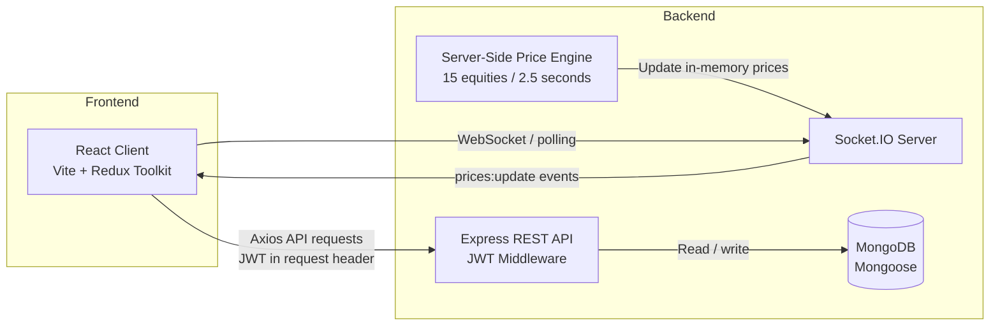
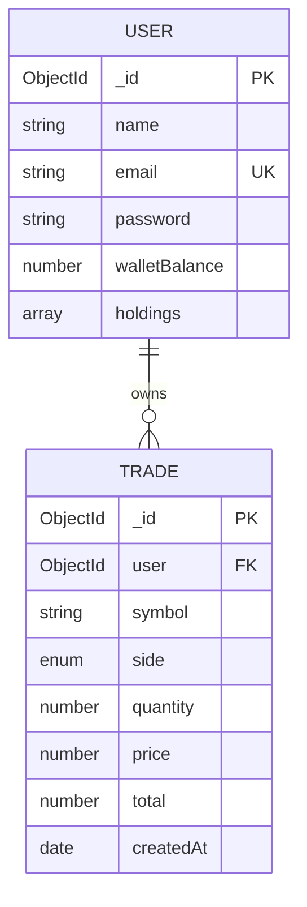

# TradeNest — Virtual Stock Trading Simulator

**A full-stack MERN paper-trading platform for practicing Indian-equity trades with real-time simulated market data.**

**Developed by Chetna Singh**

<p align="left">
  
  
  
  
  
  
  
  
  
  
  
</p>

> TradeNest is an educational trading simulator. It does not connect to a real exchange, accept real money, or provide investment advice.

## Overview

TradeNest lets users create accounts, receive a virtual wallet balance, explore Indian-equity instruments, execute simulated buy and sell orders, and monitor portfolio performance. The backend maintains a server-generated price feed and persists accounts, holdings, and completed trades in MongoDB.

### Key Features

- **Account authentication:** Registration and login, bcrypt password hashing, JWT issuance with a seven-day expiry, session restoration, and protected React routes.
- **Virtual brokerage wallet:** New users start with ₹1,00,000; successful buy and sell orders update wallet and holdings.
- **Order execution:** Validates positive whole-number quantities, supported symbols, BUY/SELL direction, available cash, and owned share quantities.
- **Portfolio analytics:** Displays wallet balance, holdings, weighted-average buy price, invested value, current value, unrealized P&L, realized P&L, and total P&L.
- **Trade history:** Retrieves completed BUY/SELL records from MongoDB and supports PDF statement export through jsPDF and jsPDF-AutoTable.
- **Real-time simulated market:** The server updates fifteen Indian-equity prices every 2.5 seconds and broadcasts snapshots with Socket.IO.
- **Market exploration:** Provides searchable markets, stock detail views, live price history, market breadth, movement charts, and allocation charts.
- **Personal watchlist:** Stores account-keyed watchlist selections in browser local storage; it is not synchronized through the backend.
- **Interface personalization:** Includes responsive layouts, mobile navigation, and light/dark theme controls.

## System Architecture



The price engine runs in server memory and is separate from MongoDB. REST operations persist users and trades, while Socket.IO distributes only the generated market snapshots.

## Database Schema & Relationships

TradeNest uses two Mongoose collections.

| Collection | Key Fields | Relationships / Behavior |
| --- | --- | --- |
| `users` | `name`, `email`, `password`, `walletBalance`, `holdings[]`, `createdAt`, `updatedAt` | Email is unique and normalized. Holdings are embedded subdocuments containing `symbol`, `quantity`, and `averagePrice`. Password hashes are excluded from normal queries. |
| `trades` | `user` (ObjectId), `symbol`, `side`, `quantity`, `price`, `total`, `createdAt`, `updatedAt` | `Trade.user` references `User._id`. The field has a MongoDB index. Side is constrained to `BUY` or `SELL`. |



Notable model rules include:

- Embedded holdings use no separate `_id`.
- `walletBalance` starts at `100000` and cannot be negative.
- Mongoose optimistic concurrency is enabled on `User`.
- The password is hashed with 12 bcrypt rounds only when it changes.
- Trade quantities, prices, totals, and holding quantities have Mongoose minimum constraints.

## Folder Structure

```text
stock-trading-simulator/
├── backend/
│   ├── config/
│   │   └── db.js
│   ├── controllers/
│   │   ├── authController.js
│   │   ├── portfolioController.js
│   │   └── tradeController.js
│   ├── middleware/
│   │   └── authMiddleware.js
│   ├── models/
│   │   ├── Trade.js
│   │   └── User.js
│   ├── routes/
│   │   ├── authRoutes.js
│   │   ├── portfolioRoutes.js
│   │   └── tradeRoutes.js
│   ├── sockets/
│   │   └── priceEngine.js
│   ├── tests/
│   │   └── trade.test.js
│   ├── utils/
│   │   └── stocks.js
│   ├── app.js
│   ├── server.js
│   ├── .env.example
│   └── package.json
├── frontend/
│   ├── public/
│   ├── src/
│   │   ├── app/
│   │   │   └── store.js
│   │   ├── assets/
│   │   ├── components/
│   │   ├── contexts/
│   │   ├── data/
│   │   ├── features/
│   │   │   ├── auth/
│   │   │   ├── portfolio/
│   │   │   └── prices/
│   │   ├── pages/
│   │   ├── services/
│   │   ├── utils/
│   │   ├── App.jsx
│   │   └── main.jsx
│   ├── .env.example
│   ├── vite.config.js
│   └── package.json
├── screenshots/
└── README.md
```

## API Endpoints Reference

| Method | Endpoint | Auth Required | Description |
| --- | --- | --- | --- |
| `GET` | `/api/health` | No | Returns `{ "status": "ok" }` for API availability checks. |
| `POST` | `/api/auth/signup` | No | Validates name, email, and password; creates a user; returns a JWT and public profile. |
| `POST` | `/api/auth/login` | No | Authenticates normalized email and password; returns a JWT and public profile. |
| `GET` | `/api/auth/me` | Yes — JWT | Restores the current account using the authenticated user ID. |
| `POST` | `/api/trades` | Yes — JWT | Executes a validated BUY or SELL and updates the user's wallet and embedded holdings. |
| `GET` | `/api/portfolio` | Yes — JWT | Returns wallet, holdings, P&L totals, and reversed trade history for the authenticated user. |

Protected routes expect:

```http
Authorization header with JWT token
```

Socket.IO also exposes the `prices:update` event. A newly connected socket receives the current in-memory price snapshot; subsequent updates are emitted every 2.5 seconds.

## Environment Variables

### Backend

| Variable | Required | Description | Example |
| --- | --- | --- | --- |
| `PORT` | No | HTTP and Socket.IO server port. Falls back to `5000`. | `5000` |
| `MONGO_URI` | Yes | MongoDB connection string. | `mongodb://127.0.0.1:27017/stock-trading-simulator` |
| `JWT_SECRET` | Yes | Secret used to sign and verify seven-day JWTs. | `replace-with-a-long-random-secret` |
| `CLIENT_URL` | No | Allowed CORS origin for REST and Socket.IO. Falls back to the Vite localhost URL. | `http://localhost:5173` |

### Frontend

| Variable | Required | Description | Example |
| --- | --- | --- | --- |
| `VITE_API_URL` | No | Base URL for REST requests. Falls back to the local API URL. | `http://localhost:5000/api` |
| `VITE_SOCKET_URL` | No | Socket.IO server URL. Falls back to the local server URL. | `http://localhost:5000` |

## Local Setup & Installation

### Prerequisites

- Node.js 20.19 or later
- npm
- MongoDB Community Server or MongoDB Atlas

### 1. Clone the repository

```bash
git clone https://github.com/chetu300/tradenest-paper-trading.git
cd stock-trading-simulator
```

### 2. Configure and start MongoDB

Start a local MongoDB instance, or create a MongoDB Atlas cluster and obtain a connection string.

### 3. Configure the backend

```bash
cd backend
cp .env.example .env
```

Set `MONGO_URI` and `JWT_SECRET` in `backend/.env`. Generate a strong secret, for example:

```bash
node -e "console.log(require('crypto').randomBytes(48).toString('hex'))"
```

Install and start the backend:

```bash
npm install
npm run dev
```

The API and Socket.IO server run at `http://localhost:5000` by default.

### 4. Configure and start the frontend

Open a second terminal:

```bash
cd frontend
cp .env.example .env
npm install
npm run dev
```

Open `http://localhost:5173`.

### 5. Verify the setup

```bash
curl http://localhost:5000/api/health
```

### Production build

```bash
cd frontend
npm run build
npm run preview
```

The Vite production bundle is generated in `frontend/dist/`. No Dockerfile or Docker Compose configuration is currently included, so Docker commands are not applicable.

### Backend tests

```bash
cd backend
npm test
```

The current Jest/Supertest suite mocks Mongoose models and covers buy/sell execution, insufficient funds, insufficient holdings, and portfolio responses.

## Deployment: Vercel + Render

The React/Vite frontend is hosted on Vercel. The Express API and Socket.IO server are hosted on Render, and MongoDB Atlas provides the database. Keep `MONGO_URI` and `JWT_SECRET` in Render environment variables only; never add secrets to the frontend or commit local `.env` files.

### 1. Deploy the backend to Render

1. Push the project to GitHub and connect the repository to Render.
2. In Render, create a **Blueprint** from the repository. The root `render.yaml` configures the backend service using `backend/` as its root directory.
3. Enter your MongoDB Atlas connection string for `MONGO_URI`. Render generates a secure `JWT_SECRET`.
4. After Vercel creates the frontend URL, set Render's `CLIENT_URL` to that exact origin, such as `https://your-app.vercel.app` (no trailing slash).
5. Wait for the Render health check to pass and verify `https://YOUR-RENDER-DOMAIN/api/health` returns `{"status":"ok"}`. Copy the Render service URL for the frontend settings.

### 2. Deploy the frontend to Vercel

1. Import the same GitHub repository into Vercel.
2. Set **Root Directory** to `frontend`. Use `npm run build` as the build command and `dist` as the output directory.
3. Add these environment variables in Vercel, replacing the example URL with the Render service URL:

   ```text
   VITE_API_URL=https://YOUR-RENDER-DOMAIN/api
   VITE_SOCKET_URL=https://YOUR-RENDER-DOMAIN
   ```

4. Deploy the project. The `frontend/vercel.json` rewrite supports client-side routes such as `/markets` and `/login`.
5. If you change Vercel environment variables, create a new frontend deployment so they are included in the build.

Never add `MONGO_URI` or `JWT_SECRET` to Vercel; keep them only in Render's backend environment variables.

## Security & Performance Highlights

- **JWT authentication:** Signup and login issue signed, seven-day tokens; protected routes verify a Bearer token in the Authorization header.
- **Password security:** Passwords are hashed with bcryptjs at cost 12 and omitted from normal user reads.
- **Server-side authorization:** Trade and portfolio operations derive the account from the verified JWT rather than a client-supplied user ID.
- **CORS allowlisting:** REST and Socket.IO use `CLIENT_URL`, with a localhost fallback.
- **Request size limit:** Express limits JSON request bodies to 20 KB.
- **Input and domain validation:** Authentication fields, positive whole-number quantities, supported symbols, trade sides, balances, and share ownership are checked on the server.
- **Optimistic concurrency:** Mongoose user documents detect overlapping account updates and return a conflict response.
- **Database indexing:** The trade `user` ObjectId reference is indexed for user-specific portfolio queries.
- **Money rounding:** Trade totals and P&L values are rounded before responses and persisted updates.
- **Efficient market delivery:** Socket.IO broadcasts a full price snapshot at a fixed 2.5-second interval rather than opening external market-feed connections.

The codebase does **not** currently include Helmet or an HTTP rate-limiting middleware. These would be recommended before a public production deployment.

## Demo Credentials & Live Links

> Create this disposable demo account through the app's sign-up page before sharing these credentials.

| Item | Demo value |
| --- | --- |
| Live Demo | [https://YOUR-LIVE-DEMO-URL.com](https://YOUR-LIVE-DEMO-URL.com) |
| Test User Email | `demo@tradenest.com` |
| Test User Password | `TradeNestDemo2026!` |
| Test Admin | No admin account or role is implemented in the current codebase. |
| Dashboard Screenshot | [screenshots/dashboard.jpg](./screenshots/dashboard.jpg) |
| Markets Screenshot | [screenshots/markets.jpg](./screenshots/markets.jpg) |
| Portfolio Screenshot | [screenshots/portfolio.jpg](./screenshots/portfolio.jpg) |
| Trade Confirmation Screenshot | [screenshots/trade-confirmation.jpg](./screenshots/trade-confirmation.jpg) |

These are suggested demo credentials, not an account seeded by the application. Use them only for a disposable demo account and never reuse the password for a personal account.
